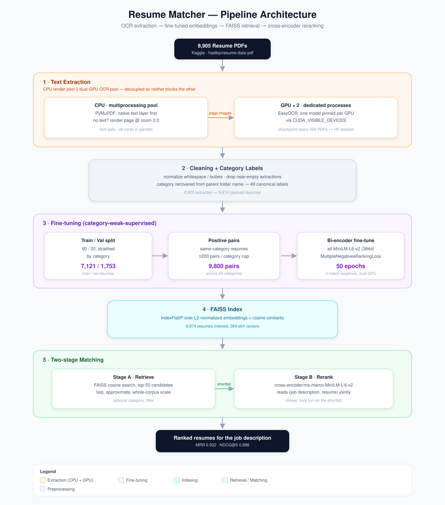
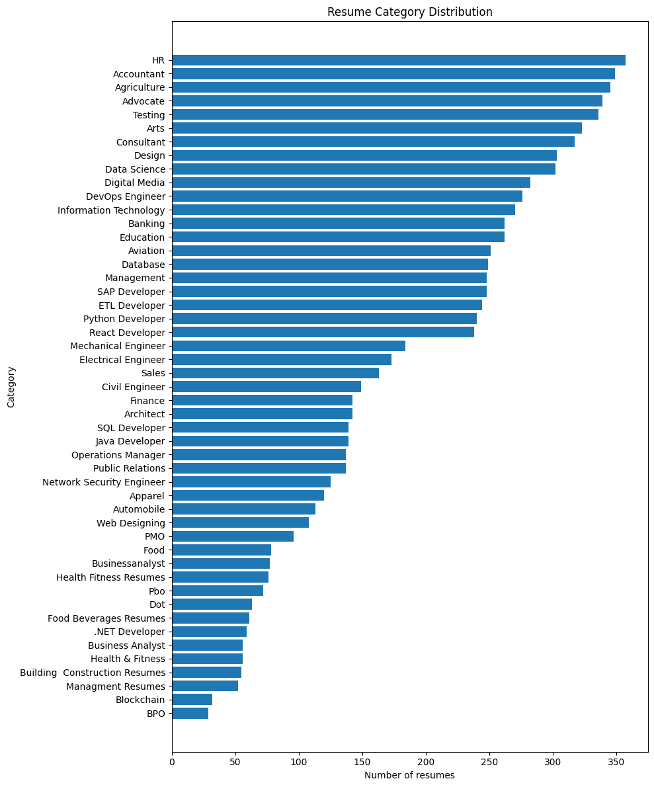
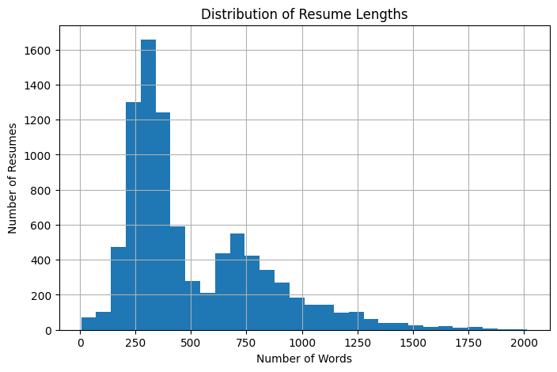
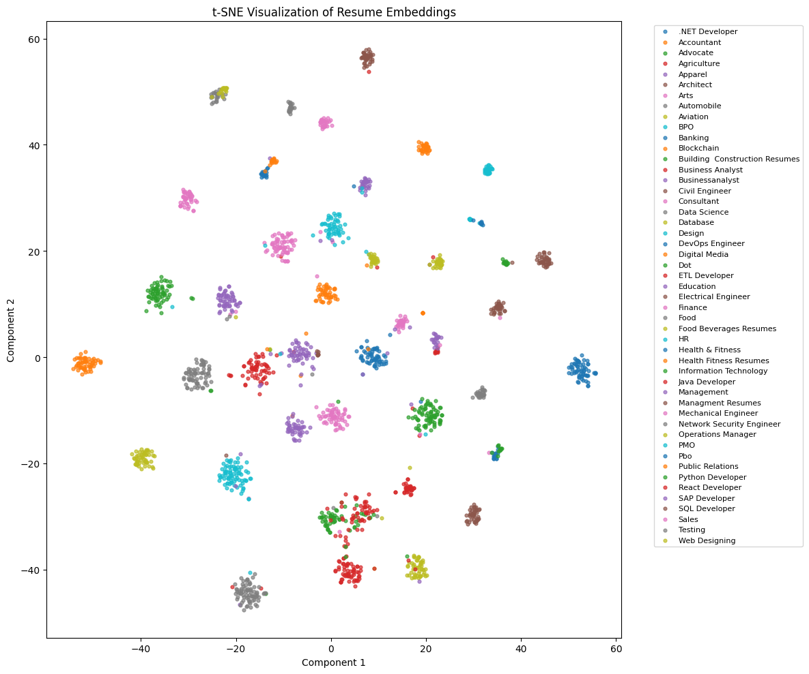
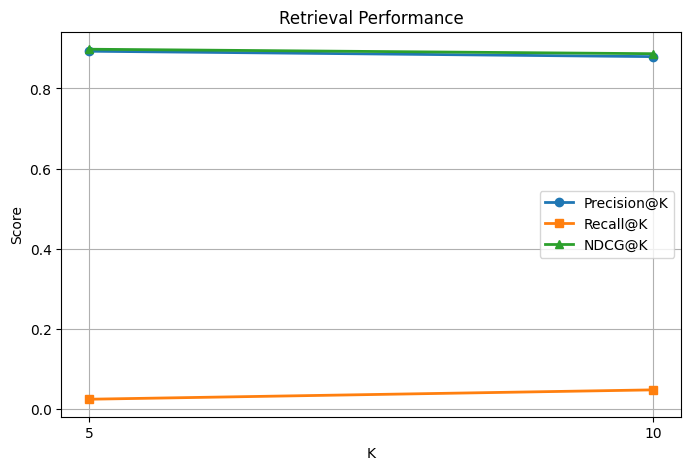

# Resume Matcher

A semantic resume-to-job-description matching system: OCR extraction from 8,905 scanned resume PDFs, a fine-tuned bi-encoder embedding model, FAISS retrieval, and cross-encoder reranking — evaluated with standard IR metrics.



## Dataset

[`hadikp/resume-data-pdf`](https://www.kaggle.com/datasets/hadikp/resume-data-pdf) on Kaggle — 8,905 resume PDFs across category-labeled folders (Accountant, HR, Python Developer, etc.), a mix of native-text and scanned-image PDFs. Downloaded via `kagglehub`.

## 1. Text extraction
      
Each page is handled in two stages:
1. **Native text first** — `PyMuPDF` pulls the embedded text layer where one exists (free, instant).
2. **OCR fallback** — pages with no usable text layer (< 20 characters) are rendered to an image at **zoom 2.0** and OCR'd with **EasyOCR on GPU**.

Rendering (CPU-bound) and OCR (GPU-bound) run as separate process pools so they don't block each other: PyMuPDF rendering is parallelized across all CPU cores, while OCR runs in dedicated worker processes — one per GPU (2× T4 here), each pinned to its own device via `CUDA_VISIBLE_DEVICES` and holding its own model instance. This split also avoids fork/CUDA-context conflicts that occur if a GPU-backed model is loaded before forking worker processes.

Progress checkpoints every 500 PDFs to survive session interruptions, uploaded to a Hugging Face dataset repo as a durable backup. All 8,905 PDFs were processed; 8,874 survived the cleaning step below (records with near-empty extracted text were dropped).

**Known limitation:** OCR output on low-quality scans contains character-level noise (e.g. "Prolile Expctierxed" instead of "Profile Experienced"). This wasn't manually audited at scale — treat downstream results as a proxy for text quality, not a guarantee of clean input.

## 2. Cleaning + category recovery

Text is normalized (control characters stripped, bullet glyphs unified, whitespace collapsed). The category label is recovered **from each PDF's parent folder name**, not from the extraction step's raw category field — the dataset's actual PDFs sit one directory level deeper than the top-level folder the extraction script walked, so folder-name-at-parse-time is the reliable source of truth. A hand-built alias table then merges folder-name variants (`"pmo"`, `"pmo resumes"` → `PMO`) into **49 canonical categories**.

8,874 of 8,905 extracted resumes survived cleaning (records with under 50 characters of text — failed extractions — were dropped).



Class sizes are imbalanced — HR and Accountant have 300+ resumes, Blockchain and BPO have under 40. This imbalance matters for both training (per-category pair caps, below) and evaluation (recall is naturally harder to move for large categories).



Most resumes land in the 200–800 word range after extraction, with a long tail up to ~2,000 words.

## 3. Train / validation split

An 80/20 split, stratified per category (`Train: 7,121  Val: 1,753`), so both fine-tuning and evaluation see every category proportionally, and evaluation measures generalization to resumes unseen during fine-tuning.

## 4. Fine-tuning: why and how

**The problem with off-the-shelf embeddings:** a general-purpose sentence embedding model (`all-MiniLM-L6-v2`) is trained on generic sentence-similarity data, not resumes. It has no notion of *this dataset's* specific categories or the vocabulary that separates, say, a DevOps Engineer resume from a Network Security Engineer resume — two categories that share a lot of surface vocabulary (Linux, AWS, security tooling) but represent different roles.

**The fix — weak supervision from category labels:** category labels aren't "job description query → relevant resume" pairs, but they're a usable proxy: two resumes from the same category are more semantically alike than two from different categories. We turn every same-category resume pair into a **positive pair** and fine-tune with `MultipleNegativesRankingLoss` — for each pair in a training batch, every *other* item in the batch is treated as an implicit negative. This is a standard contrastive/in-batch-negatives setup: it pulls same-category resumes together in embedding space and pushes different-category resumes apart, without needing explicit negative mining.

- Base model: `sentence-transformers/all-MiniLM-L6-v2` (384-dim)
- Pairs: up to 200 per category (caps large categories from dominating the batch composition) → **9,800 training pairs** across 49 categories
- Loss: `MultipleNegativesRankingLoss`
- 50 epochs, batch size 32, dual-GPU `DataParallel`

**A caveat worth being explicit about:** this objective teaches the model to cluster resumes *by category label*, which is not the same thing as teaching it "matches a job description well." It's a reasonable and cheap proxy given no labeled job-description/resume pairs exist, but it means the model could be learning superficial category vocabulary rather than deeper job-fit semantics. The t-SNE plot below is consistent with this — tight, well-separated clusters by category is exactly what this objective optimizes for, so it's expected rather than independent confirmation of matching quality.



## 5. Indexing

All 8,874 cleaned resumes are embedded with the fine-tuned model and added to a FAISS `IndexFlatIP` (exact inner-product search). Embeddings are L2-normalized before indexing, which makes inner product mathematically equivalent to cosine similarity — a standard trick to get cosine search out of an inner-product index without a separate distance function.

## 6. Matching: two-stage retrieve-then-rerank

A single embedding model has to compress a whole resume into one vector, which loses information a cross-encoder can recover by reading the query and candidate *together*. But a cross-encoder can't run over the full corpus — it doesn't produce cacheable per-item vectors, so every query needs a fresh forward pass for every candidate. The standard resolution is two stages:

1. **Retrieve**: FAISS cosine search returns the top-50 candidates by embedding similarity — fast, approximate, runs over the whole corpus.
2. **Rerank**: `cross-encoder/ms-marco-MiniLM-L-6-v2` scores the job description against each of those 50 candidates jointly, and the top-K by that score is returned. Slower per-item, but only run on a short list.

## 7. Evaluation

There's no labeled ground truth of "this resume is a good match for this job." As a proxy, each held-out validation resume's own text is used as a stand-in query, and any other resume **of the same category** is treated as relevant. This tests whether the matcher retrieves resumes from a semantically consistent domain — a reasonable sanity check, but not a substitute for real recruiter-judged relevance.

Metrics: **Precision@K**, **Recall@K**, **Mean Reciprocal Rank (MRR)**, and **NDCG@K** (Normalized Discounted Cumulative Gain — rewards relevant results appearing earlier in the ranked list, discounted logarithmically by rank position).

### Results (200 sampled validation queries)

| Metric | K=5 | K=10 |
|---|---|---|
| Precision@K | 0.893 | 0.880 |
| Recall@K | 0.024 | 0.048 |
| NDCG@K | 0.898 | 0.887 |

**MRR: 0.932**



**Reading Recall@K honestly:** it looks alarmingly low next to the other metrics, but this is expected given how the eval is constructed, not a bug. Large categories (HR, Accountant) have 300+ members, so "recall" against the *whole* category in just the top 5–10 results is capped low by definition — Recall@K can only approach 1.0 if K approaches the category size. Precision and NDCG are the metrics that actually reflect ranking quality here; Recall@K would need a much larger K (or a smaller, filtered candidate pool) to be a meaningful number for this dataset's class sizes.

## Repository structure

```
.
├── README.md
├── resume_matcher_notebook.ipynb   # end-to-end pipeline: extraction → fine-tuning → matching → eval
├── ocr_workers.py                   # multiprocessing-safe render + dual-GPU OCR workers
├── assets/                          # result plots referenced in this README
└── (not committed) resume_embedder_finetuned/, resumes.faiss, metadata.jsonl, checkpoints/
```

> `resume_embedder_finetuned/` (model weights), `resumes.faiss` (index), and the OCR `checkpoints/` are large binary artifacts — keep them out of git and either regenerate them by running the notebook, or host them on Hugging Face/Kaggle and download at setup time (which is already how OCR checkpoints are backed up in this project).

## Running it

1. Get a Kaggle API credential and set `KAGGLE_USERNAME` / `KAGGLE_KEY` (or use Kaggle Notebooks, where the dataset can be attached directly).
2. GPU runtime recommended for OCR (dual-GPU support built in) and fine-tuning; a single GPU or CPU both work, just slower.
3. Run `resume_matcher_notebook.ipynb` top to bottom.
4. Call `match(job_description)` to get a ranked shortlist, or `match(job_description, category_filter="Python Developer")` to restrict to one category.

## Limitations & next steps

- **Eval is a category proxy, not ground truth.** Validating against real job postings with recruiter-judged relevant resumes would be the meaningful next step.
- **OCR noise is unaudited at scale.** A manual review of a larger OCR sample, or an OCR quality filter (e.g. flagging high non-dictionary-word ratios), would surface how much of the corpus is degraded.
- **Fine-tuning objective is category clustering, not job-fit.** If real job/resume relevance pairs become available, fine-tuning directly on those (rather than the category-label proxy) would better target the actual task.
- **Multi-column resume layouts** are a known OCR reading-order risk not specifically handled here.
- **FAISS `IndexFlatIP` is exact but doesn't scale indefinitely** — fine up to a few hundred thousand vectors; a persistent/filterable store (e.g. Chroma, or an IVF/HNSW FAISS index) would be needed beyond that.
